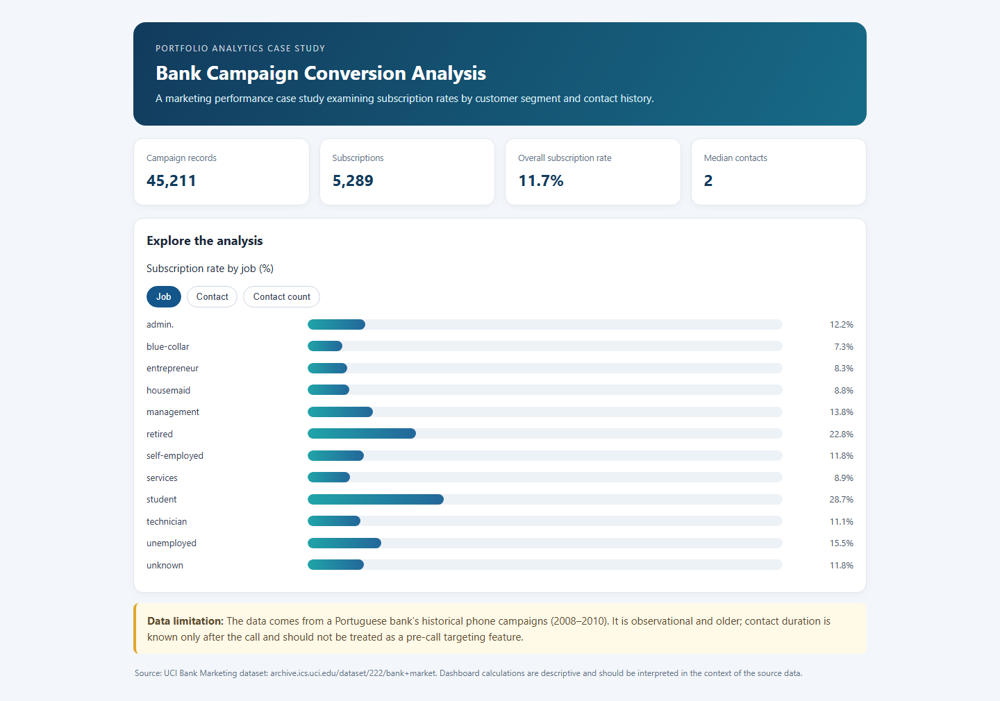

# Bank Campaign Conversion Analysis

## Project summary
A bank marketing team wants to understand which customer groups responded to historical phone campaigns and how subscription rates varied across customer segments and campaign contact counts.

## Business questions
1. What was the overall subscription rate in the historical records?
2. How did subscription rates vary by job group and contact type?
3. How did observed subscription rates vary with the number of campaign contacts?
4. Which findings warrant further investigation, and what data would improve the analysis?

## Dataset
`bank-full.csv` — 45,211 historical records from a Portuguese bank’s phone campaigns (2008–2010). Source: [UCI Bank Marketing](https://archive.ics.uci.edu/dataset/222/bank%2Bmarket), DOI 10.24432/C5K306, CC BY 4.0.

## Key findings
- The records include **5,289 subscriptions**, an overall rate of **11.7%**.
- The student segment has a **28.7%** observed subscription rate across 938 records; the blue-collar segment has **7.3%** across 9,732 records.
- Subscription rates vary across campaign-contact count groups, but the data does not show that extra contacts caused the difference.

## Dashboard

[Open the interactive dashboard](https://nilesh581.github.io/bank-campaign-conversion-analysis/dashboard.html). Click the tabs to compare conversion by job, contact type, and campaign contact count. The dashboard is self-contained; the source file is `dashboard.html`.

## Methods and limitations
The included Python script uses pandas for data preparation and segment comparisons. These are historical observational records, not evidence of current customer behavior or causal effects. Call duration is only known after a call and is not appropriate as a pre-call targeting feature. The data does not include campaign cost or profit.

## Resume bullet
Analyzed 45,211 historical bank campaign records with Python and pandas; measured an 11.7% overall subscription rate, compared conversion across customer and contact segments, and built an interactive performance dashboard.

## Rebuild the dashboard
Install the dependencies with `python -m pip install pandas openpyxl`, then run `python build_dashboard.py` from this folder. The script reads the included dataset and regenerates `dashboard.html`. (The churn and bank projects only require pandas; openpyxl is needed for the retail Excel dataset.)
